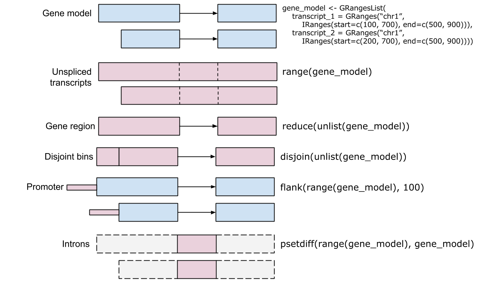
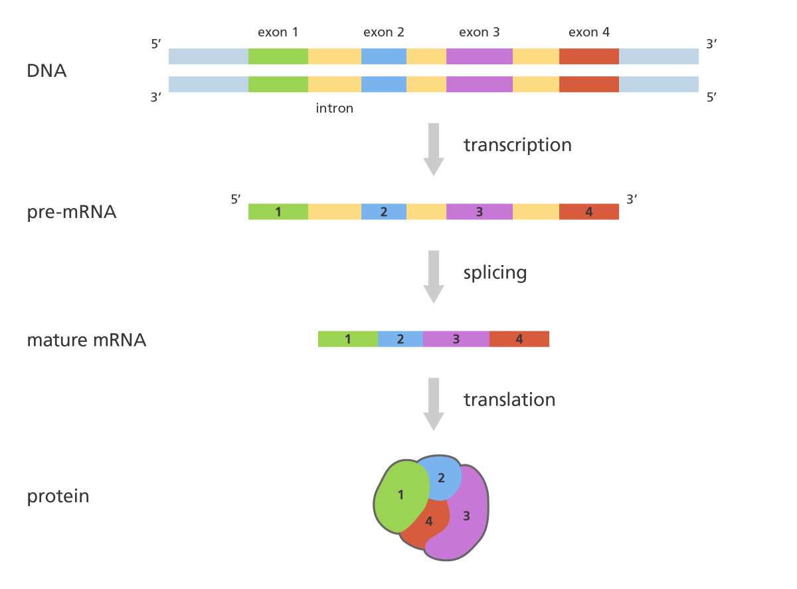

## What is **Bioconductor**?

### Bioinformatics has always benefited from curated packages and repositories.

There is no need to reinvent the wheel!

```{r fig1_biostuff, echo = FALSE, out.width = "70%"}
knitr::include_graphics("images/biostuff.jpg")
```

### In **R**, we have **Bioconductor**

```{r fig2_llogo, echo = FALSE, out.width = "50%"}

```

Bioconductor provides tools for the analysis and comprehension of high-throughput genomic data.

**The broad goals of the Bioconductor project are:**

-   To provide a **common software platform** that enables the rapid development and deployment of **extensible, scalable, and interoperable** software.

-   To provide widespread access to a broad range of powerful **statistical and graphical methods** for the analysis of genomic data.

-   To facilitate the **inclusion of biological metadata** in the analysis of genomic data, e.g. literature data from PubMed, annotation data from Entrez genes.

-   To further scientific understanding by producing **high-quality documentation** and reproducible research.

-   To **train researchers** on computational and statistical methods for the analysis of genomic data.

### How does it look like

\[https://www.bioconductor.org/\]

```{r fig4, echo = FALSE, out.width = "100%"}
knitr::include_graphics("images/screenshot.jpg")
```

## What is **Biostrings**?

```{r}
if (!requireNamespace("BiocManager", quietly = TRUE))
    install.packages("BiocManager")

if (!requireNamespace("Biostrings", quietly = TRUE))
    BiocManager::install("Biostrings")
if (!requireNamespace("pwalign", quietly = TRUE))
    BiocManager::install("pwalign")

library(Biostrings)
library(pwalign)
```

Efficient manipulation of biological strings:

-   DNA / RNA / AA Sequences
-   Alignments

### Sequences

Sequences are treated as objects which can be made of individual entries

```{r, echo = TRUE, eval = TRUE}
stSingle <- DNAString("ACTGCTAGCTAGATTAGGCTCCTATCAGA")
stSingle
```

or multiple, which are called sets:

```{r, echo = TRUE, eval = TRUE}
stSet <- DNAStringSet(c("ACTGCTAGCTAGATTAGGCTCCTATCAGA", "CTAGCTAGATTAGGCTCCTCATCAGAATCGAGTAACA"))
stSet
```

### Alignments

Pairwise alignments (local and global) are made with the **pwalign** package (this function used to be part of **Biostrings**)

pairwiseAlignment

```{r, echo = TRUE, eval = TRUE}
stSingle1 <- DNAString("ACTGCTAGCTAGATTAGGCTCCTAGCATCTAGA")
stSingle2 <- DNAString("CTAGGCTAGATTAGGCTCCTAGCATCAGACGATCGAGTAACA")
```

```{r aln, echo = TRUE, eval = TRUE}
pwalign::pairwiseAlignment(stSingle1, stSingle2, type = "local")
```

and while it can not do multiple alignments, it can read them:

-   `readDNAMultipleAlignment()`

-   `readRNAMultipleAlignment()`

-   `readAAMultipleAlignment()`

## **Reading Data**

Fasta files are read with functions:

-   `readBStringSet()`

-   `readDNAStringSet()`

-   `readRNAStringSet()`

-   `readAAStringSet()`

Let's read all *C. elegans* coding genes:

```{r readf, echo = TRUE, eval = TRUE}
cds <- readDNAStringSet("data/Caenorhabditis_elegans.WBcel235.cds.first_20.fa.gz")
cds
```

Or proteins:

```{r readfp, echo = TRUE, eval = TRUE}
pep <- readAAStringSet("data/Caenorhabditis_elegans.WBcel235.pep.first_20.fa.gz")
pep
```

## **Manipulating a String Set**

**Biostrings** objects respond to typical R syntax for their manipulation.

```{r subsb, echo = TRUE, eval = TRUE}
pep[width(pep) >= 530]
```

In some cases, functions have the same name as in base R but when applied to a **Biostrings** object you will get the **Biostrings** functionality:

For example:

```{r, echo = TRUE, eval = TRUE}
length(pep)
```

```{r, echo = TRUE, eval = TRUE}
head(pep)
```

```{r, echo = TRUE, eval = TRUE}
width(pep) # analogous to nchar() 
```

## **Counting Patterns/Characters**

Lets recycle this sequence

```{r, echo = TRUE, eval = TRUE}
stSingle <- DNAString("ACTGCTAGCTAGATTAGGCTCCTAGCATCAGA")
```

Instead of `grep()`, **Biostrings** allows to match or count substrings to a subject, for example

```{r countp, echo = TRUE, eval = TRUE}
countPattern("AGA", stSingle)
matchPattern("AGA", stSingle)
```

We can also benefit of knowing that these are Biological sequences and use [IUPAC codes instead](https://www.bioinformatics.org/sms/iupac.html) For example:

```         
R:  A or G
Y:  C or T
```

```{r countp2, echo = TRUE, eval = TRUE}
countPattern("R", stSingle, fixed = F)
matchPattern("R", stSingle, fixed = F)
countPattern("Y", stSingle, fixed = F)
matchPattern("Y", stSingle, fixed = F)
```

This function work only on `XXString` object and do not work on `XXStringSet` object. How can we count patterns in multiple sequences?

```{r}
vcountPattern("AACGA",
              stSet,
              max.mismatch=2,
              min.mismatch=1)
```

## **More functionality**

Transformations like translation or reverse are also available:

```{r translate, echo = TRUE, eval = TRUE}
translate(stSingle)
```

```{r reverse, echo = TRUE, eval = TRUE}
reverse(stSingle)
```

```{r reversecomp, echo = TRUE, eval = TRUE}
reverseComplement(stSingle)
```

Subseting based on position:

```{r subseq, echo = TRUE, eval = TRUE}
subseq(stSingle, start = 3, end = 7)
```

Frequency of letters:

```{r freq, echo = TRUE, eval = TRUE}
alphabetFrequency(stSingle)
```

```{r freq2, echo = TRUE, eval = TRUE}
alphabetFrequency(stSingle, baseOnly = TRUE, as.prob = TRUE)
```

Frequency of K-mers:

```{r freq3, echo = TRUE, eval = TRUE}
oligonucleotideFrequency(stSingle, width = 3)
```

Converting to character vector:

```{r char, echo = TRUE, eval = TRUE}
toString(stSingle)
```

##### Task

a)  Create a function `genSeq` that will randomly generate a DNA sequence of length *n_len*.

```{r}
# randomly generate a sequence

```

b)  Create a DNAStringSet object `dna` with two sequences names *seq1* and *seq2* of length 1010 and 5305.

```{r}
# set seed to 41

```

c)  Calculate the GC content.

```{r}

```

d)  Select only the *first* sequence in a `seq1` variable .

```{r}

```

e)  Subset the *first* sequence so it start with the first `ATG`.

```{r}

```

## What is **GenomicRanges**?

### Genomic locations within Bioconductor project

*GenomicRanges* package defines general purpose containers for storing and manipulating genomic intervals and variables defined along a genome

```{r fig1_ranges, echo = FALSE, out.width = "100%"}

```

### Instalation and use

Install with:

```{r install_granges, echo = TRUE, eval = FALSE}
if (!requireNamespace("BiocManager", quietly = TRUE))
  install.packages("BiocManager")
BiocManager::install("GenomicRanges")
```

Libraries you're gonna need for this lecture:

```{r run_lecture, echo = TRUE, eval = TRUE,  message=FALSE, warning=FALSE}
library(data.table) # load before IRanges so that shift() is IRanges::shift
library(GenomicRanges)
library(IRanges)
# library(ggbio)
library(ggplot2)
library(magrittr)
```

## **IRanges** package

### Foundation of integer range manipulation in Bioconductor

#### IRanges object structure

IRanges object:

```{r iranges, echo = TRUE, eval = TRUE}
(range_1 <- IRanges(start = 5, end = 11))
```

Let's look at the structure:

```{r iranges2, echo = TRUE, eval = TRUE}
str(range_1)
```

::: callout-tip
We can access *start*, *end*, *width* and other slots using `@`, but this is not recommended.\
The best approach is to use in-built functions.
:::

Let's create another IRanges object:

```{r iranges3, echo = T, eval = T}
(range_2 <- IRanges(start = c(5, 7, 1), 
                    width = c(6, 9, 3)))
```

#### Basic slots

Accessing *start*, *end* and *width* is simple:

```{r, echo = T, eval = T}
start(range_2)
```

```{r, echo = T, eval = T}
end(range_2)
```

```{r, echo = T, eval = T}
width(range_2)
```

#### Some other basic methods

**Joining ranges:**

```{r,  echo = T, eval = T}
c(range_1, range_2)
```

**Subset:**

```{r,  echo = T, eval = T}
range_2[2:3]
```

```{r,  echo = T, eval = T}
range_2[width(range_2) > 4]
```

::: callout-important
**Arithmetic operations** on `IRanges` do not mean adding to or subtracting from coordinates directly --- instead, they **expand or contract the ranges symmetrically**.

-   `range + k` expands each range by `k` bases on **both** sides.
-   `range - k` contracts each range by `k` bases on **both** sides.

This means:

$$
\text{new start} = \text{old start} - k
$$

$$
\text{new end} = \text{old end} + k
$$

$$
\text{new width} = \text{old width} + 2k
$$
:::

```{r,  echo = T, eval = T}
range_2
```

```{r,  echo = T, eval = T}
range_2 + 1
```

```{r,  echo = T, eval = T}
range_2 - 1
```

**Reverse ranges:**

The function `rev()` reverses the order of the ranges in the IRanges object --- not their coordinates.

```{r,  echo = T, eval = T}
rev(range_2)
```

**Counting number of ranges over each position:**

The function `coverage()` counts, for every genomic position, **how many ranges overlap** that position.\
It returns an object of class `Rle` (Run-Length Encoding), which efficiently stores repeated values.

```{r,  echo = T, eval = T}
coverage(range_2)
```

## **IRanges** methods overview

::: callout-important
**Set operations**

Set operations on *IRanges* object reflect traditional mathematical set operations *complement*, *union*, *intersect*, and *difference*. There are two variants for each operation:

-   the first treats each *IRanges* object as a set and returns a normal value
-   the other has a parallel semantic (like pmin/pmax) and performs the operation for each range pairing separately

```         
(p)union() # union
(p)intersect() # intersect
(p)setdiff() # difference
(p)gaps() # complement
```

**Intra range methods**

Intra range methods transform each range individually and independently of other ranges. They return an object parallel to the input object - the *i-th* range corresponds to the *i-th* range in the input.

```         
shift()
narrow()
resize()
flank()
promoters()
reflect()
restrict()
```

**Inter range methods**

Inter range methods transform all the ranges as a set to produce a new set of ranges. They return an object that is generally NOT parallel to the input object.

```         
range()
reduce()
disjoin()
```
:::

#### Exploring methods

In order to understand what is each of those functions doing, we will create a helper functions to visualize *IRanges*. We want to plot ranges and result of the method applied to those ranges - all on one plot. We will use *ggplot2* which accepts table as input. First we need to create a function which will join ranges and result of the method to one table. We need unique identifier for each range and result of the method so we can plot them in different colors. Something like this:

```         
IRangesMethodToTable(method, range_1, range_2)
```

### Ranges-to-table function

Function takes ranges and method as input and returns ranges and result of the method in one table:

```{r, IRangesMethodToTable, eval = T, echo = T}
IRangesMethodToTable <- function(IRangesMethod, ...){

  # apply method to IRanges
  irange_result <- IRangesMethod(...)

  # create list of IRanges
  irange_list <- list(..., irange_result)

  # loop through the list: transform to table, add unique id
  irange_tb <- lapply(seq_along(irange_list), function(index){

    if(class(irange_list[[index]]) %in% c("IRanges", "GRanges")){
      as.data.table(irange_list[[index]])[, range_id := index]
    }

  })

  # bind to one table (NULLs are skipped, missing columns filled with NA)
  irange_tb <- rbindlist(irange_tb, use.names = TRUE, fill = TRUE)

  # replace last added range with NA
  irange_tb[, range_id := fifelse(range_id == max(range_id),
                                  NA_character_,
                                  paste("range", range_id, sep = "."))]

  # return table
  return(irange_tb)

}
```

Test run:

```{r}
range_1 <- IRanges(start = c(4, 18, 1), 
                   width = c(3, 4, 3))
range_2 <- IRanges(start = c(8, 3, 16), 
                   width = c(5, 10, 4))
joined_ranges_tb <- IRangesMethodToTable(IRanges::union, range_1, range_2)

print(joined_ranges_tb)
```

### Plot table

Function takes table from last step and plots ranges and result of the method:

```{r plotIRanges, eval = T, echo = T}
plotIRanges <- function(irange_tb){
  
  # calculate max. x-limit
  xlim_max <- max(irange_tb$end)
  
  # copy so the input table is not modified by reference
  irange_tb <- copy(as.data.table(irange_tb))

  # add range_ymin to separate ranges on y-axis
  irange_tb[, range_ymin := 1:.N]

  # add range ID if it doesn't exist
  if(!("range_id" %in% names(irange_tb))){
    irange_tb[, range_id := "range.1"]
  }
  
  # plot
  ggplot(irange_tb, aes(xmin = start, xmax = end, 
                        ymin = range_ymin - 1, ymax = range_ymin - 0.1, 
                        fill = range_id)) + 
    geom_rect() +
    scale_x_continuous(breaks = 1:xlim_max) +
    scale_y_reverse() +
    scale_fill_grey(start = 0.8, end = 0.3, na.value = "red3") +
    theme_bw() +
    theme(axis.text.y = element_blank(),
          axis.ticks.y = element_blank(),
          panel.grid.minor.x = element_blank(),
          panel.grid.major.y = element_blank(),
          panel.grid.minor.y = element_blank(),
          legend.position = "none")
  
}
```

## Set operations

Set operations reflect traditional mathematical set operations complement, union, intersect, and difference.

### *union()* and *punion()*

```{r, eval = T, echo = T, fig.height = 2, fig.width = 6}
IRangesMethodToTable(IRanges::union, range_1, range_2) %>% plotIRanges(.)
```

::: callout-note
**Important arguments of `punion(x, y, ...)`**

`punion()` works pair by pair (1st range of x with 1st range of y, 2nd with 2nd, ...) and must return **exactly one range per pair**.

-   **`fill.gap`** - what to do when the two ranges of a pair do not overlap (there is a gap between them), so their union would be two separate pieces:
    -   `FALSE` (default) - error: *"some pair of ranges have a gap within the 2 members of the pair"*
    -   `TRUE` - return one range from the smallest start to the largest end, **filling the gap**

Here every pair has a gap (4-6 and 8-12, 18-21 and 3-12, 1-3 and 16-19), so without `fill.gap = TRUE` this code fails. Note that the result also covers positions which are in **neither** range (e.g. 1-19 for the 3rd pair) - the set version `union()` never does that.
:::

```{r, eval = T, echo = T, fig.height = 2, fig.width = 6}
IRangesMethodToTable(punion, range_1, range_2, fill.gap = TRUE) %>% plotIRanges(.)
```

### *intersect()* and *pintersect()*

```{r, eval = T, echo = T}
range_1 <- IRanges(start = c(9, 18, 1), end = c(13, 22, 9))
range_2 <- IRanges(start = c(8, 3, 2), end = c(13, 20, 5))
```

```{r, eval = T, echo = T, fig.height = 2, fig.width = 6}
IRangesMethodToTable(IRanges::intersect, range_1, range_2) %>% plotIRanges(.)
```

::: callout-note
**Important arguments of `pintersect(x, y, ...)`**

Like `punion()`, `pintersect()` works pair by pair and returns exactly one range per pair.

-   **`resolve.empty`** - what to do when the two ranges of a pair do not overlap. Their intersection is then an **empty range** (width 0), but an empty range still needs a start position:
    -   `"none"` (default) - error: *"some intersections produce ambiguous empty ranges"*
    -   `"max.start"` - the empty range starts at the larger of the two starts
    -   `"start.x"` - the empty range starts at the start of the range from x

For example `10-15` and `20-25` give an empty range starting at 20 with `"max.start"` and at 10 with `"start.x"`. In our example all three pairs overlap, so `resolve.empty` does not change the result here.
:::

```{r, eval = T, echo = T, fig.height = 2, fig.width = 6}
IRangesMethodToTable(pintersect, range_1, range_2, resolve.empty = "max.start") %>% plotIRanges(.)
```

### *setdiff()* and *psetdiff()*

```{r, echo = T, eval = T}
range_1 <- IRanges(start = c(4, 18, 1), end = c(7, 22, 4))
range_2 <- IRanges(start = c(10, 4, 16), end = c(13, 13, 20))
```

```{r, eval = T, echo = T, fig.height = 2, fig.width = 6}
IRangesMethodToTable(IRanges::setdiff, range_1, range_2) %>% plotIRanges(.)
```

```{r, eval = T, echo = T, fig.height = 2, fig.width = 6}
IRangesMethodToTable(psetdiff, range_1, range_2) %>% plotIRanges(.)
```

### *gaps()* and *pgaps()*

`gaps()` accepts only one IRanges object as an argument. It is also one of the inter-range transformations.

```{r, echo = T, eval = T}
range_1 <- IRanges(start = c(4, 18, 1), end = c(7, 22, 4))
range_2 <- IRanges(start = c(10, 3, 16), end = c(13, 13, 20))
```

```{r, eval = T, echo = T, fig.height = 2, fig.width = 6}
IRangesMethodToTable(gaps, c(range_1, range_2)) %>% plotIRanges(.)
```

```{r, eval = T, echo = T, fig.height = 2, fig.width = 6}
IRangesMethodToTable(pgap, range_1, range_2) %>% plotIRanges(.)
```

## Intra range operations

Intra range methods transform each range individually and independently of other ranges. They return an object parallel to the input object - *i-th* range corresponds to the *i-th* range in the input.

### *shift()*

```{r, echo = T, eval = T}
range_1 <- IRanges(start = c(4, 5, 8, 3, 16), 
                   end = c(9, 9, 13, 13, 20))
```

::: callout-note
**Important arguments of `shift(x, shift)`**

-   **`shift`** - by how many positions to move each range. The width stays the same:
    -   positive number - move to the **right** (e.g. `shift = 7`: 4-9 becomes 11-16)
    -   negative number - move to the **left** (e.g. `shift = -2`: 4-9 becomes 2-7)
:::

```{r, eval = T, echo = T, fig.height = 2, fig.width = 6}
IRangesMethodToTable(shift, range_1, shift = 7) %>% plotIRanges(.)
```

```{r, eval = T, echo = T, fig.height = 2, fig.width = 6}
IRangesMethodToTable(shift, range_1, shift = -2) %>% plotIRanges(.)
```

### *narrow()*

Relative start and end positions: start at 3rd and end at 5th position

::: callout-note
**Important arguments of `narrow(x, start, end, width)`**

-   **`start`**, **`end`** - positions **relative to the range itself**, not genome coordinates: `1` is the first position of the range. Here range 4-9 with `start = 3, end = 5` keeps its 3rd to 5th position, i.e. 6-8
-   negative values count from the end of the range: `start = -2` keeps the last two positions (8-9)
-   **`width`** - can be given instead of one of `start` / `end`
:::

```{r, eval = T, echo = T, fig.height = 2, fig.width = 6}
IRangesMethodToTable(narrow, range_1[1], start=3, end=5) %>% plotIRanges(.)
```

### *resize()*

The `width` argument is the **new width** of each range. The `fix` argument determines **which part of each range remains constant** when resizing its width.

-   **`fix = "start"`**\
    The **start coordinate** stays fixed.\
    The end position shifts to achieve the new width.\
    (Equivalent to `start = TRUE` logic in other functions.)

-   **`fix = "end"`**\
    The **end coordinate** stays fixed.\
    The start position shifts to adjust the width.

-   **`fix = "center"`**\
    The **midpoint** of the range stays constant, and the range expands or contracts **symmetrically** on both sides.

```{r, eval = T, echo = T, fig.height = 2, fig.width = 6}
IRangesMethodToTable(resize, range_1[1], width = 4, fix = "start") %>% plotIRanges(.)
```

```{r, eval = T, echo = T, fig.height = 2, fig.width = 6}
IRangesMethodToTable(resize, range_1[1:3], width = 2, fix = "center") %>% plotIRanges(.)
```

### *flank()*

When using the `flank()` function, several arguments control where the flanking regions are placed:

-   **`width`**:\
    The **length** of the flanking region.

-   **`start = TRUE`**:\
    The flanking region is generated **relative to the start** of each range.

-   **`start = FALSE`**:\
    The flanking region is generated **relative to the end** of each range.

-   **`both = TRUE`**:\
    The flanking region extends **to both sides of the reference point** (start or end) --- for example, with `width = 2` and `start = TRUE`, the region covers two bases **before the start** and the **first two bases of the range** (range 4-9 gives 2-5).

```{r, eval = T, echo = T, fig.height = 2, fig.width = 6}
IRangesMethodToTable(flank, range_1[1], width = 2, start = TRUE) %>%  plotIRanges(.)

IRangesMethodToTable(flank, range_1, width = 2, start = TRUE) %>%  plotIRanges(.)
```

```{r, eval = T, echo = T, fig.height = 2, fig.width = 6}
IRangesMethodToTable(flank, range_1[1], width = 2, start = TRUE, both = TRUE) %>% plotIRanges(.)
```

### *promoters()*

Similar to *flank()*, but takes start as reference point.

::: callout-note
**Important arguments of `promoters(x, upstream, downstream)`**

-   **`upstream`** - how many positions **before** the start to include
-   **`downstream`** - how many positions **from** the start onward to include (the start itself counts)

Here range 4-9 with `upstream = 3, downstream = 2` gives 1-5: three positions before the start (1-3) and the first two of the range (4-5). On a GRanges object with `strand = "-"` the start is the right end of the range, so upstream is to the right.
:::

```{r, eval = T, echo = T, fig.height = 2, fig.width = 6}
IRangesMethodToTable(promoters, upstream = 3, downstream = 2, range_1[1]) %>% plotIRanges(.)
```

### *reflect()*

Reflects (mirrors) the input range(s) relative to the midpoint of the specified bounds (e.g., (10, 11)), flipping the ranges as though the bounds define the axis of reflection.

::: callout-note
**Important arguments of `reflect(x, bounds)`**

-   **`bounds`** - an IRanges object whose midpoint is the mirror. Here `bounds = 10-11`, so the mirror is at 10.5 and range 4-9 becomes 12-17. If `bounds` has one range it is used for all ranges of x, otherwise it must have one range per range of x

Because `bounds` is itself an IRanges object, our `IRangesMethodToTable()` function treats it as an input range and it is also drawn on the plot.
:::

```{r, eval = T, echo = T, fig.height = 2, fig.width = 6}
IRangesMethodToTable(reflect, range_1, bounds = IRanges(start = 10, end = 11)) %>% plotIRanges(.)
```

### *restrict()*

The function `restrict()` **trims or limits ranges** to lie within specified boundaries.\
It's used when you want to **keep only the portions of ranges that fall inside a given interval**.

::: callout-note
**Important arguments of `restrict(x, start, end, keep.all.ranges)`**

-   **`start`**, **`end`** - the boundaries (genome coordinates). Parts of ranges outside 3-9 are cut off, e.g. 8-13 becomes 8-9
-   **`keep.all.ranges`** - what to do with ranges that lie **completely outside** the boundaries:
    -   `FALSE` (default) - they are dropped (here 16-20 disappears, so the result has 4 ranges instead of 5)
    -   `TRUE` - they are kept as empty ranges (width 0)
:::

```{r, eval = T, echo = T, fig.height = 2, fig.width = 6}
IRangesMethodToTable(restrict, range_1, start = 3, end = 9) %>% plotIRanges(.)
```

## Inter range operations

Inter range methods transform all the ranges as a set to produce a new set of ranges. They return an object that is generally NOT parallel to the input object.

### *range()*

The function `range()` returns **one range from the smallest start to the largest end** of all ranges - the region which covers everything, including the gaps between ranges.\
For example, the whole region spanned by all exons of a gene. Here ranges 3-13 and 16-20 give 3-20 (position 14-15 is in no range, but is included).

```{r, eval = T, echo = T, fig.height = 2, fig.width = 6}
IRangesMethodToTable(range, range_1) %>% plotIRanges(.)
```

### *reduce()*

The function `reduce()` **merges overlapping (and touching) ranges** into one, but **keeps the gaps** between them. The result is the smallest set of non-overlapping ranges which cover exactly the same positions as the input.\
For example, merging overlapping reads or exons of all transcripts of a gene into regions which are covered at least once. Here 4-9, 5-9, 8-13 and 3-13 are merged into 3-13, and 16-20 stays on its own.

::: callout-note
**Important arguments of `reduce(x, min.gapwidth)`**

-   **`min.gapwidth`** - ranges separated by a gap **smaller** than this are merged. Default is `1`, so only overlapping or touching ranges (e.g. 1-3 and 4-6) are merged. With `min.gapwidth = 2`, 1-3 and 5-8 (gap of one position) are also merged into 1-8
:::

```{r, eval = T, echo = T, fig.height = 2, fig.width = 6}
IRangesMethodToTable(reduce, range_1) %>% plotIRanges(.)
```

### *disjoin()*

The function `disjoin()` **cuts the ranges at every start and end**, so that the result consists of non-overlapping pieces, and each position is covered by exactly the same input ranges within a piece.\
For example, splitting exons of different transcripts into parts which are shared by all transcripts and parts which are unique to some of them. Here 4-9 and 8-13 give three pieces: 4-7 (only in the 1st range), 8-9 (in both) and 10-13 (only in the 2nd range).

::: callout-tip
Compare the three methods on the same ranges: `range()` gives **1** range (gaps filled), `reduce()` gives as **few** ranges as possible (gaps kept), `disjoin()` gives as **many** pieces as needed so that no two pieces overlap.
:::

```{r, eval = T, echo = T, fig.height = 2, fig.width = 6}
IRangesMethodToTable(disjoin, range_1[c(1,3)]) %>% plotIRanges(.)
```

## Interval overlaps

There are several methods for finding and counting interval overlaps between two IRanges object - query and a subject.

### *findOverlaps()*

```{r, eval = T, echo = T, fig.height = 2, fig.width = 6}
(overlaps <- findOverlaps(range_1, range_2))
```

Extracting overlapping ranges from result is done with `queryHits()` and `subjectHits()`.

```{r, eval = T, echo = T, fig.height = 2, fig.width = 6}
(query_ranges <- range_1[queryHits(overlaps)])
```

```{r, eval = T, echo = T, fig.height = 2, fig.width = 6}
(subject_ranges <- range_2[subjectHits(overlaps)])
```

### *countOverlaps()*

```{r, eval = T, echo = T, fig.height = 2, fig.width = 6}
countOverlaps(range_1, range_2)
```

```{r, eval = T, echo = T, fig.height = 2, fig.width = 6}
countOverlaps(range_2, range_1)
```

### *subsetByOverlaps()*

The function `subsetByOverlaps()` returns **only the ranges from one set that overlap another set**.

```{r, eval = T, echo = T, fig.height = 2, fig.width = 6}
subsetByOverlaps(range_1, range_2)
```

## GenomicRanges methods overview

::: callout-important
GenomicRanges = IRanges + genomic info. Used to describe:

-   annotations, e.g., exons, genes, binding sites, ...
-   data, e.g., aligned reads, called peaks, copy number regions
:::

For example:

```{r, eval = T, echo = T, fig.height = 2, fig.width = 6}
(grange_1 <- GRanges("chr1", range_1, strand = "+"))
```

```{r, eval = T, echo = T, fig.height = 2, fig.width = 6}
(grange_2 <- GRanges("chr2", range_2, strand = "-"))
```


::: callout-important

`seqnames` vs `seqlevels` in GenomicRanges

When working with genomic ranges (`GRanges` objects), each range is associated with a **sequence name** — typically a chromosome or contig.  
Two related functions, `seqnames()` and `seqlevels()`, are used to access this information, but they serve different purposes.

`seqnames()`
  - Returns the **sequence name (chromosome)** for **each individual range**.  
  - The output is a vector with one entry per range.

`seqlevels()`
  - Returns the **set of unique sequence** names (chromosomes) present or allowed in the object.
  - This defines the **reference genome structure** — even if some levels currently have no ranges.


Few additional functions to access new data:
```{r, eval = T, echo = T, fig.height = 2, fig.width = 6}
seqnames(grange_1) # chromosomes, but can also be contigs, scaffolds etc.
```

```{r, eval = T, echo = T, fig.height = 2, fig.width = 6}
seqlevels(grange_1)
```

```{r, eval = T, echo = T, fig.height = 2, fig.width = 6}
strand(grange_1)
```

```{r, eval = T, echo = T, fig.height = 2, fig.width = 6}
ranges(grange_1)
```

Adding additional metadata:

```{r, eval = T, echo = T, fig.height = 2, fig.width = 6}
mcols(grange_1)$exon_id <- 1:length(grange_1)
mcols(grange_2)$exon_id <- length(grange_2):1
mcols(grange_1)$transcript_id <- "tx_1"
mcols(grange_2)$transcript_id <- "tx_2"
grange_1
```

```{r, eval = T, echo = T, fig.height = 2, fig.width = 6}
mcols(grange_2)
```

:::

## *GRanges* methods overview

All methods which work on *IRanges* objects also work on *GRanges*, with some limitations and/or additional arguments. For example:

```{r, eval = T, echo = T, warrnings = F}
grange_1
grange_2
(overlaps <- findOverlaps(grange_1, grange_2))
```

Why are there no overlaps? Seqnames/seqlevels are different!

```{r, eval = T, echo = T, warrnings = F}
seqlevels(grange_2) <- "chr1"
grange_1
grange_2
```

```{r, eval = T, echo = T, warrnings = F}
(overlaps <- findOverlaps(grange_1, grange_2))
```

Why are there still no overlaps? Strands are different!

::: callout-note
**`ignore.strand`** - GRanges methods by default compare only ranges on the **same strand** (`"*"` matches both `"+"` and `"-"`).

-   `FALSE` (default) - ranges on `"+"` and `"-"` never overlap
-   `TRUE` - strand is ignored and only the positions are compared. Methods that return new ranges, like `intersect()`, then return them with strand `"*"`
:::

```{r, eval = T, echo = T, warrnings = F}
(overlaps <- findOverlaps(grange_1, grange_2, ignore.strand = T))
```

Another example:

```{r, eval = T, echo = T, warrnings = F}
IRangesMethodToTable(GenomicRanges::intersect, grange_1, grange_2, ignore.strand = T) %>% plotIRanges(.)
```

Input data to *GRanges* from table:

```{r, eval = T, echo = T, warrnings = F}
ranges_tb <- data.table::data.table(chromosomes = paste("chr", sample(1:10, 5)), 
                     gene_start = c(1, 8, 5, 3, 2), 
                     gene_end = c(12, 13, 15, 8, 6), 
                     gene_strand = sample(c("+", "-"), 5, replace = T), 
                     gene_id = paste0("gene_", sample(1:10, 5)), 
                     score = sample(1:100, 5))
 print(ranges_tb)
```

```{r, eval = T, echo = T, warrnings = F}
makeGRangesFromDataFrame(df = ranges_tb, 
                         seqnames.field = "chromosomes",
                         start.field = "gene_start", 
                         end.field = "gene_end", 
                         strand.field = "gene_strand", 
                         keep.extra.columns = TRUE)
```

If your column names are correct you can directly call `GRanges()` on data.frame/tibble/data.table:

```{r, eval = T, echo = T, warrnings = F}
(ranges_tb <- GRanges(data.table::data.table(seqnames = paste("chr", sample(1:10, 5)), 
                             start = c(1, 8, 5, 3, 2), 
                             end = c(12, 13, 15, 8, 6), 
                             strand = sample(c("+", "-"), 5, replace = T), 
                             gene_id = paste0("gene_", sample(1:10, 5)), 
                             score = sample(1:100, 5))))
```

## *GRangesList* methods overview

Used when you want to store exons in transcripts or aligned reads with gaps/paired-end reads.

```{r, eval = T, echo = T, warrnings = F}
grange_1_2 <- c(grange_1, grange_2)
(grange_list <- split(grange_1_2, mcols(grange_1_2)$transcript_id))
```

Subset:

```{r, eval = T, echo = T, warrnings = F}
grange_list[[1]] 
# also works: grange_list$"tx_1"
```

Accessors and interval operations from *GRanges* also work on *GRangesList*, but usually return a list. For example:

```{r, eval = T, echo = T, warrnings = F}
seqnames(grange_list)
```

```{r, eval = T, echo = T, warrnings = F}
ranges(grange_list)
strand(grange_list)
start(grange_list)
# and so on ...
```

You can also use mathematical and other operations on them:

```{r, eval = T, echo = T, warrnings = F}
sum(width(grange_list))
```

Most of the *intra*-, *inter*- and *between*-range methods also operate on *GRangesList* objects:

```{r, eval = T, echo = T, warrnings = F}
shift(grange_list, 20)
```

*GRangesList* to *GRanges*:

```{r, eval = T, echo = T, warrnings = F}
unlist(grange_list)
```

Loops - `lapply()`, `sapply()`, `mapply()`, `endoapply()`, `mendoapply()`, `Map()` and `Reduce()`:

```{r, eval = T, echo = T, warrnings = F}
lapply(grange_list, length)
```

```{r, eval = T, echo = T, warrnings = F}
sapply(grange_list, length)
```

`endoapply()` transforms an object to another instance of the same class:

```{r, eval = T, echo = T, warrnings = F}
endoapply(grange_list, rev)
```

Overlap *GRangesList* with *GRanges*:

```{r, eval = T, echo = T, warrnings = F}
findOverlaps(c(grange_1, grange_2), grange_list)
```

## Additional resources

### Cheat sheets

*Bioconductor* cheatsheet: https://rpubs.com/Pazz/bioc_cheat_sheet

*Bioconductor* for Genomic Data Science: http://kasperdanielhansen.github.io/genbioconductor/

### Some other useful packages to have in mind:

*GenomicFeatures* - import and query gene models

*GenomicAlignments* - representation and manipulation of short genomic alignments

*rtracklayer* - R interface to genome annotation files and the UCSC genome browser

*BSgenome* - efficient representation of full genomes and their SNPs

*ggbio* - visualization tools for genomic data

### Biological terminology

#### Gene structure

```{r genes, echo = FALSE, out.width = "100%"}

```

Upstream/downstream vs. sense/antisense vs. plus/minus strand
