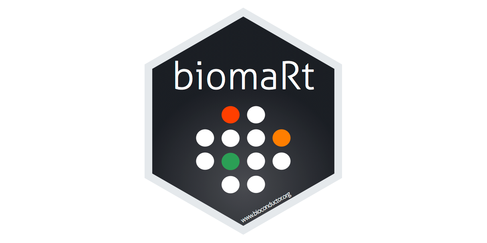

## What is **biomaRt**?

### Interface to BioMart databases (most importantly, Ensembl)

**biomaRt** is an R package that provides an interface to [BioMart databases](https://jun2026.archive.ensembl.org/biomart/martview), most importantly to Ensembl.

```{r fig1_biomart, echo = FALSE, out.width = "80%"}

```

### Ensembl

```{r fig2_ensembl, echo = FALSE, out.width = "50%"}

```

The Ensembl genome database project is a scientific project at the European Bioinformatics Institute (EMBL-EBI). It provides a centralized resource for geneticists, molecular biologists and other researchers studying the genomes of our own species and other vertebrates and model organisms. [wiki](https://en.wikipedia.org/wiki/Ensembl_genome_database_project)

[Ensembl](https://www.ensembl.org/) is a genome browser for vertebrate genomes that supports research in comparative genomics, evolution, sequence variation and transcriptional regulation. Ensembl annotates genes, computes multiple alignments, predicts regulatory function and collects disease data. Ensembl tools include BLAST, BioMart and the Variant Effect Predictor (VEP).

::: callout-important
## BioMart in 2026: what changed?

-   In 2026 Ensembl moved to a **new website** at <https://www.ensembl.org>. **BioMart did not move to the new site.** Ensembl is developing a different data-mining tool to replace it.
-   **Ensembl 116 (June 2026) is the last release with BioMart.** Older releases stay available as *archive* sites (e.g. <https://jun2026.archive.ensembl.org>, <https://e115.ensembl.org>).
-   The Ensembl **mirrors** (copies of the website in other parts of the world, `useast.ensembl.org` and `asia.ensembl.org`) are **retired**. Code you find online that uses `mirror = "useast"` or `mirror = "asia"` will not work anymore.
-   Because of this, **biomaRt** versions up to 2.68 **fail** with the default settings:

``` text
Error in .getArchiveList(http_config = http_config) :
  Unable to contact any Ensembl mirror
```

**The fix:** always tell biomaRt which Ensembl site to use with the `host` argument. In this lecture we use the Ensembl 115 site, which also works with older biomaRt versions:

```{r host}
ensembl_host <- "https://e115.ensembl.org"
```

Data dumps (FASTA, GTF, ...) remain available on the [Ensembl FTP server](https://ftp.ensembl.org/pub/). More info: [Bioconductor support post](https://support.bioconductor.org/p/9163834/).
:::

### Install

**biomaRt** is part of *Bioconductor*:

```{r install, eval = FALSE}
if (!require("BiocManager", quietly = TRUE))
  install.packages("BiocManager")

BiocManager::install("biomaRt")
```

```{r load}
library(biomaRt)
library(data.table)
```

### Identifying the database and datasets in Ensembl

To list the available BioMart databases (marts) on our Ensembl site:

```{r list_marts}
listMarts(host = ensembl_host)
```

Next, we connect to one database (`"genes"` = `ENSEMBL_MART_ENSEMBL`) and list its datasets:

```{r list_datasets}
ensembl <- useEnsembl(biomart = "genes", host = ensembl_host)
datasets <- listDatasets(ensembl)
head(datasets)
```

We can also search through datasets using a pattern:

```{r search_datasets}
searchDatasets(mart = ensembl, pattern = "hsapiens")
```

To select a dataset:

```{r use_dataset, eval = FALSE}
ensembl <- useDataset(dataset = "hsapiens_gene_ensembl", mart = ensembl)
```

If you know the database and dataset in advance, you can do it in one step:

```{r use_ensembl}
ensembl <- useEnsembl(biomart = "genes",
                      dataset = "hsapiens_gene_ensembl",
                      host = ensembl_host)
```

## How to query Ensembl from R?

The main query function is `getBM()`. It has four main arguments:

-   `attributes` - the output of the query (a vector of attributes you want to retrieve)

-   `filters` - how to filter the query (a vector of filters used in the query)

-   `values` - which values to use for the filters (if multiple filters are used, `values` must be a list)

-   `mart` - an object of class `Mart` created by the `useEnsembl()` function

### How to build a biomaRt query?

Filters and values define restrictions on the query. For example, if you want to restrict the output to all genes located on the human X chromosome, use the **filter** *chromosome_name* with the **value** *"X"*.

### Filters

To see all available filters in the selected dataset:

```{r list_filters}
filters <- listFilters(ensembl)
filters[1:5, ]
```

You can search through filters by pattern:

```{r search_filters}
searchFilters(mart = ensembl, pattern = "ensembl.*id")
```

Note that you can use regular expressions (regex) in `pattern`.

You can also list all possible values of a filter:

```{r filter_options}
listFilterOptions(mart = ensembl, filter = "chromosome_name")[1:10]
```

### Attributes

Attributes define the data we want to retrieve, for example gene symbols or chromosomal coordinates. To display all available attributes in the selected dataset:

```{r list_attributes}
attributes <- listAttributes(ensembl)
attributes[1:5, ]
```

You can also search through attributes by pattern:

```{r search_attributes}
searchAttributes(mart = ensembl, pattern = "hgnc")
```

### Example

Get gene IDs and coordinates for 3 human genes: *DICER1*, *AGO2* and *FILIP1*:

```{r getbm_example}
getBM(attributes = c("external_gene_name", "ensembl_gene_id",
                     "chromosome_name", "start_position", "end_position", "strand"),
      filters = "external_gene_name",
      values = c("DICER1", "AGO2", "FILIP1"),
      mart = ensembl)
```

### Multiple filters

When we use more than one filter, `values` must be a **list** with one element per filter. For example, all protein-coding genes on chromosome 21:

```{r getbm_multiple_filters}
chr21_genes <- getBM(attributes = c("external_gene_name", "ensembl_gene_id",
                                    "start_position", "end_position"),
                     filters = c("chromosome_name", "biotype"),
                     values = list("21", "protein_coding"),
                     mart = ensembl)
setDT(chr21_genes)
head(chr21_genes)
chr21_genes[, .N]
```

## Obtaining sequences

All sequence-related queries to Ensembl are available through the `getSequence()` wrapper function. Sequences can be retrieved starting either from chromosomal coordinates or from identifiers.

The type of sequence returned is set by the `seqType` argument, which takes the following values:

-   *cdna*
-   *peptide* for protein sequences
-   *3utr* for 3' UTR sequences
-   *5utr* for 5' UTR sequences
-   *gene_exon* for exon sequences only
-   *transcript_exon* for transcript-specific exonic sequences only
-   *transcript_exon_intron* gives the full unspliced transcript, that is exons + introns
-   *gene_exon_intron* gives the exons + introns of a gene
-   *coding* gives the coding sequence only
-   *coding_transcript_flank* gives the flanking region of the transcript including the UTRs
-   *coding_gene_flank* gives the flanking region of the gene including the UTRs
-   *transcript_flank* gives the flanking region of the transcript excluding the UTRs
-   *gene_flank* gives the flanking region of the gene excluding the UTRs

For example, to get the 5' UTR sequences of our 3 genes:

```{r get_sequence}
five_prime_utr_seq <- getSequence(id = c("DICER1", "AGO2", "FILIP1"),
                                  type = "external_gene_name",
                                  seqType = "5utr",
                                  mart = ensembl)
setDT(five_prime_utr_seq)
five_prime_utr_seq[, .N]
# show only the first 50 nucleotides of each sequence
five_prime_utr_seq[, `5utr` := substr(`5utr`, 1, 50)]
head(five_prime_utr_seq)
```

::: callout-tip
We get one sequence per **transcript**, which is why there are more rows than genes. Transcripts without an annotated 5' UTR return `"Sequence unavailable"`.

To save sequences in FASTA format, use `exportFASTA(sequences, file = "my_sequences.fa")`.
:::

## Finding mouse orthologs

**Orthologs** are genes in different species that evolved from the same ancestral gene. A very common task is: *"I have a list of human genes, what are the matching mouse genes?"* (or the other way around).

In Ensembl, orthologs are stored as **attributes** of a dataset. For every species there is a group of attributes starting with the species name, e.g. `mmusculus_homolog_...` for mouse:

```{r ortholog_attributes}
searchAttributes(mart = ensembl, pattern = "mmusculus_homolog")
```

::: callout-tip
## How do we know which attributes to ask for?

Look at the output of `searchAttributes()` above:

-   the **`name`** column is exactly what we write in the `attributes` argument of `getBM()` (e.g. `"mmusculus_homolog_associated_gene_name"`)
-   the **`description`** column tells us what the attribute contains (e.g. *Mouse gene name*)

So we read the descriptions, pick the ones we need and copy their names into `getBM()`. To browse the whole table, use `View(searchAttributes(mart = ensembl, pattern = "mmusculus_homolog"))` in RStudio/Positron.
:::

### Human → mouse

We stay in the **human** dataset (`ensembl`), filter by human gene names and ask for the mouse homolog attributes:

```{r human_to_mouse}
getBM(attributes = c("external_gene_name", "ensembl_gene_id",
                     "mmusculus_homolog_associated_gene_name",
                     "mmusculus_homolog_ensembl_gene",
                     "mmusculus_homolog_orthology_type",
                     "mmusculus_homolog_perc_id",
                     "mmusculus_homolog_orthology_confidence"),
      filters = "external_gene_name",
      values = c("DICER1", "AGO2", "FILIP1", "AMY1A"),
      mart = ensembl)
```

What do the columns mean?

-   `mmusculus_homolog_associated_gene_name` / `mmusculus_homolog_ensembl_gene` - name and Ensembl ID of the mouse gene
-   `mmusculus_homolog_orthology_type` - the type of relationship (see below)
-   `mmusculus_homolog_perc_id` - % of the mouse protein sequence identical to the human protein
-   `mmusculus_homolog_orthology_confidence` - 1 = high confidence, 0 = low confidence

*AMY1A* returns empty values: Ensembl does not report a mouse ortholog for it. Orthologs in Ensembl are predicted automatically from gene trees, and for gene families with many similar copies (like the amylase genes) the prediction is sometimes missing.

::: callout-note
## Orthology types

-   **ortholog_one2one** - one human gene matches exactly one mouse gene
-   **ortholog_one2many** - one human gene matches several mouse genes (the gene was duplicated in mouse), or the other way around
-   **ortholog_many2many** - several human genes match several mouse genes
:::

### Mouse → human

To go the other way, we use the **mouse** dataset and the `hsapiens_homolog_...` attributes:

```{r mouse_to_human}
mouse <- useEnsembl(biomart = "genes",
                    dataset = "mmusculus_gene_ensembl",
                    host = ensembl_host)

getBM(attributes = c("external_gene_name", "ensembl_gene_id",
                     "hsapiens_homolog_associated_gene_name",
                     "hsapiens_homolog_ensembl_gene",
                     "hsapiens_homolog_orthology_type"),
      filters = "external_gene_name",
      values = c("Dicer1", "Ago2", "Filip1"),
      mart = mouse)
```

### Other species

Ensembl has ortholog attributes for around 200 species, all named `<species>_homolog_...`. Searching for `"_homolog"` would return thousands of rows (\~14 attributes per species), so we search for just one attribute per species to get the list of species:

```{r ortholog_species}
ortholog_species <- searchAttributes(mart = ensembl, pattern = "_homolog_associated_gene_name")
setDT(ortholog_species)
ortholog_species[, .N]
head(ortholog_species)
```

`pattern` is also matched against the `description`, so we can search by the common name of a species, e.g. zebrafish:

```{r zebrafish_attributes}
searchAttributes(mart = ensembl, pattern = "Zebrafish")
```

The zebrafish attributes start with `drerio_homolog_`. Now we query them the same way as for mouse:

```{r human_to_zebrafish}
getBM(attributes = c("external_gene_name",
                     "drerio_homolog_associated_gene_name",
                     "drerio_homolog_orthology_type",
                     "drerio_homolog_perc_id"),
      filters = "external_gene_name",
      values = c("DICER1", "AGO2", "FILIP1"),
      mart = ensembl)
```

*FILIP1* has **two** zebrafish orthologs (*filip1a* and *filip1b*), so its type is *ortholog_one2many*. This is common in zebrafish, because its genome went through an extra whole-genome duplication during fish evolution.

### Many genes at once

We can combine filters with ortholog attributes. For example, the mouse orthologs of all human protein-coding genes on chromosome 21:

```{r chr21_orthologs}
chr21_orthologs <- getBM(attributes = c("ensembl_gene_id", "external_gene_name",
                                        "mmusculus_homolog_associated_gene_name",
                                        "mmusculus_homolog_orthology_type"),
                         filters = c("chromosome_name", "biotype"),
                         values = list("21", "protein_coding"),
                         mart = ensembl)
setDT(chr21_orthologs)

# number of rows vs. number of unique human genes
chr21_orthologs[, .N]
chr21_orthologs[, uniqueN(ensembl_gene_id)]

# how many rows of each orthology type? (empty = no mouse ortholog)
chr21_orthologs[, .N, by = mmusculus_homolog_orthology_type]

# keep only the clear one-to-one orthologs
chr21_one2one <- chr21_orthologs[mmusculus_homolog_orthology_type == "ortholog_one2one"]
head(chr21_one2one)
```

::: callout-tip
We get **more rows than genes**: if a human gene has several mouse orthologs, it appears once for every mouse gene. Genes without a mouse ortholog have empty values (`""` or `NA`) in the mouse columns. Before using the results (e.g. comparing human and mouse expression), decide how to handle these cases - often only **one2one** orthologs are kept.
:::

## Additional resources

*biomaRt* vignette: <https://bioconductor.org/packages/release/bioc/vignettes/biomaRt/inst/doc/accessing_ensembl.html>

Ensembl archives: <https://www.ensembl.org/help/articles/archives>

Ensembl FTP (bulk downloads of genomes, annotations and sequences): <https://ftp.ensembl.org/pub/>
